# 🐾 Rede PetVida: Banco de Dados para Clínicas Veterinárias

Trabalho Final do 2º Bimestre de Modelagem de Banco de Dados, implementado em PostgreSQL no Supabase.

## 1. Cenário

A **Rede PetVida** tem clínicas veterinárias em 8 capitais brasileiras. Ela atende cães, gatos, aves e coelhos e mantém uma farmácia própria.

**Problema:** cada clínica controla os atendimentos em planilhas. O histórico do animal não é compartilhado entre as unidades (nem as alergias), não existe uma agenda única e a gerência não tem como acompanhar o faturamento e os medicamentos mais usados.

**Solução:** um banco de dados único com tutores, animais, prontuários, veterinários, consultas e medicamentos prescritos.

### Regras de negócio

1. Um tutor tem CPF e e-mail únicos, um endereço e pode ter vários telefones.
2. Um tutor tem um ou mais animais, e cada animal pertence a um único tutor.
3. Cada animal tem exatamente um prontuário.
4. Uma consulta é de um animal com um veterinário e pode estar *Agendada*, *Realizada* ou *Cancelada*.
5. Uma consulta pode prescrever vários medicamentos, e um medicamento pode aparecer em várias consultas.
6. A idade do animal e o valor total da consulta são calculados, não digitados.

### Entidades e atributos

| Entidade | Atributos |
|---|---|
| TUTOR | <u>id_tutor</u>, nome, cpf, email, data_nascimento, data_cadastro, **endereco** (logradouro, numero, bairro, cidade, uf, cep), **{telefone}** |
| ANIMAL | <u>id_animal</u>, nome, especie, raca, sexo, data_nascimento, peso_kg, *idade* |
| PRONTUARIO | <u>id_prontuario</u>, numero_prontuario, data_abertura, castrado, alergias, observacoes |
| VETERINARIO | <u>id_veterinario</u>, nome, crmv, especialidade, email, data_admissao, salario |
| CONSULTA | <u>id_consulta</u>, data_hora, tipo, motivo, diagnostico, valor_consulta, status, *valor_total* |
| MEDICAMENTO | <u>id_medicamento</u>, nome_comercial, principio_ativo, forma, fabricante, preco_unitario, estoque |

### Tipos de atributos

| Tipo | Exemplo |
|---|---|
| Simples | `nome`, `cpf`, `especie` |
| Composto | `endereco` (logradouro, número, bairro, cidade, UF, CEP) |
| Multivalorado | `telefone` do tutor |
| Derivado | `idade` do animal e `valor_total` da consulta |
| Chave primária | `id_tutor`, `id_animal`, `id_consulta`… |

### Relacionamentos

| Relacionamento | Entidades | Tipo |
|---|---|---|
| TEM | Animal — Prontuário | 1:1 |
| POSSUI | Tutor — Animal | 1:N |
| RECEBE | Animal — Consulta | 1:N |
| REALIZA | Veterinário — Consulta | 1:N |
| PRESCREVE | Consulta — Medicamento | N:N |

## 2. Modelagem Conceitual

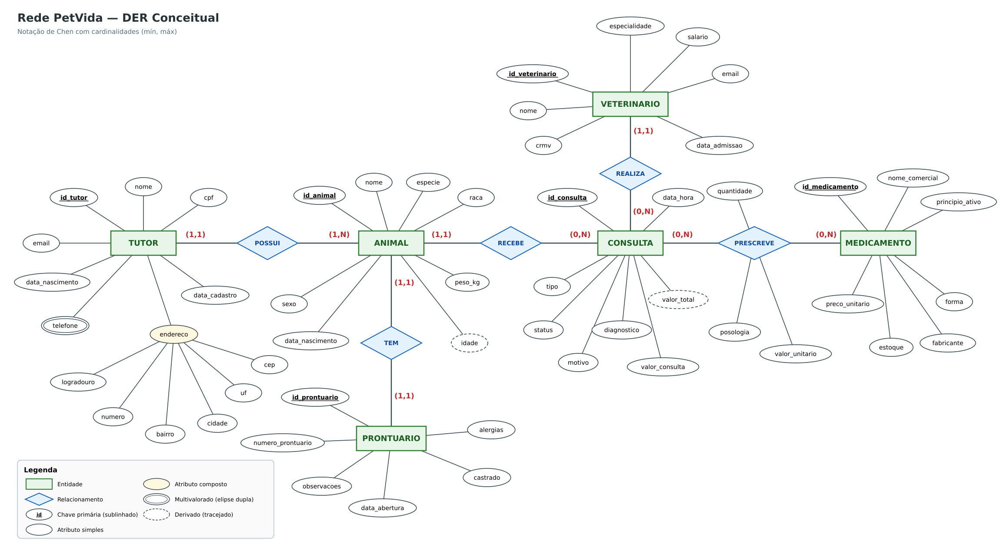

Cardinalidades no formato (mínimo, máximo). Legenda: elipse sublinhada = chave primária, elipse dupla = multivalorado, elipse tracejada = derivado, elipse amarela com ramificações = composto.

## 3. Modelagem Lógica

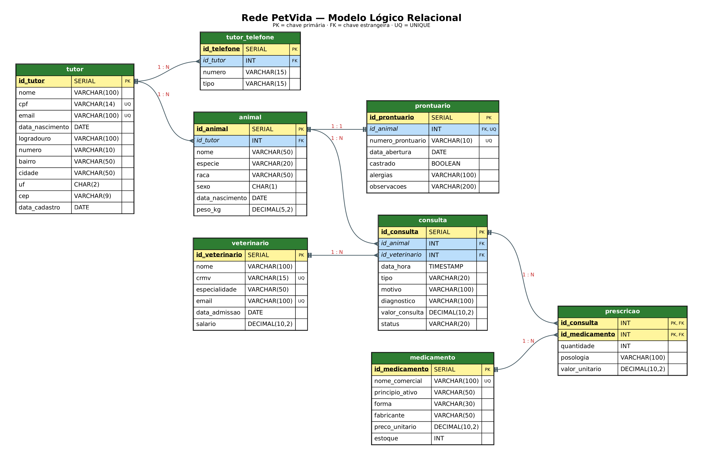

Como o DER virou tabelas:

| No DER | No modelo lógico |
|---|---|
| Atributo composto `endereco` | 6 colunas na tabela `tutor` |
| Atributo multivalorado `telefone` | tabela `tutor_telefone` |
| Atributos derivados | não viram coluna: são calculados nas views `vw_animal_idade` e `vw_consulta_valor_total` |
| 1:1 Animal–Prontuário | FK `id_animal` em `prontuario`, com `UNIQUE` |
| 1:N | FK no lado N (`animal.id_tutor`, `consulta.id_animal`, `consulta.id_veterinario`) |
| N:N Consulta–Medicamento | tabela `prescricao`, com chave primária composta pelas duas FKs |

Tipos de dados: `SERIAL` (ids), `VARCHAR`/`CHAR` (textos), `DATE` e `TIMESTAMP` (datas), `DECIMAL` (valores e peso), `INT` (quantidades) e `BOOLEAN` (sim/não).

## 4. Modelagem Física

Scripts em [`scripts_sql/`](scripts_sql/), executados nesta ordem no SQL Editor do Supabase:

1. [`04_criacao_tabelas.sql`](scripts_sql/04_criacao_tabelas.sql): tabelas e views
2. [`05_carga_dados.sql`](scripts_sql/05_carga_dados.sql): dados
3. [`06_crud.sql`](scripts_sql/06_crud.sql): CRUD
4. [`07_relatorios.sql`](scripts_sql/07_relatorios.sql): relatórios

A integridade é garantida com `PRIMARY KEY`, `REFERENCES` (chaves estrangeiras), `NOT NULL`, `UNIQUE` (cpf, email, crmv e o 1:1 do prontuário) e `CHECK` (sexo, espécie, status, valores positivos).

**Criação das tabelas**
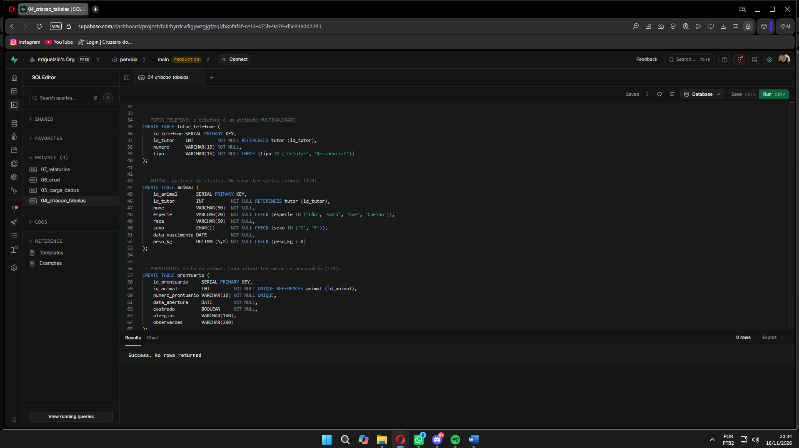

**Tabelas no Table Editor**
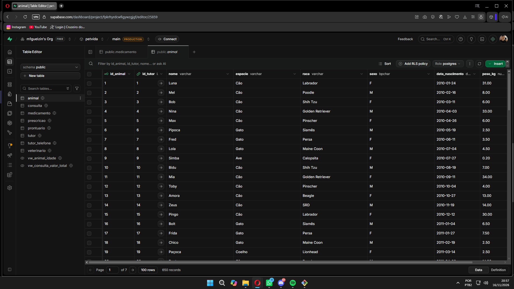

**Diagrama no Schema Visualizer**
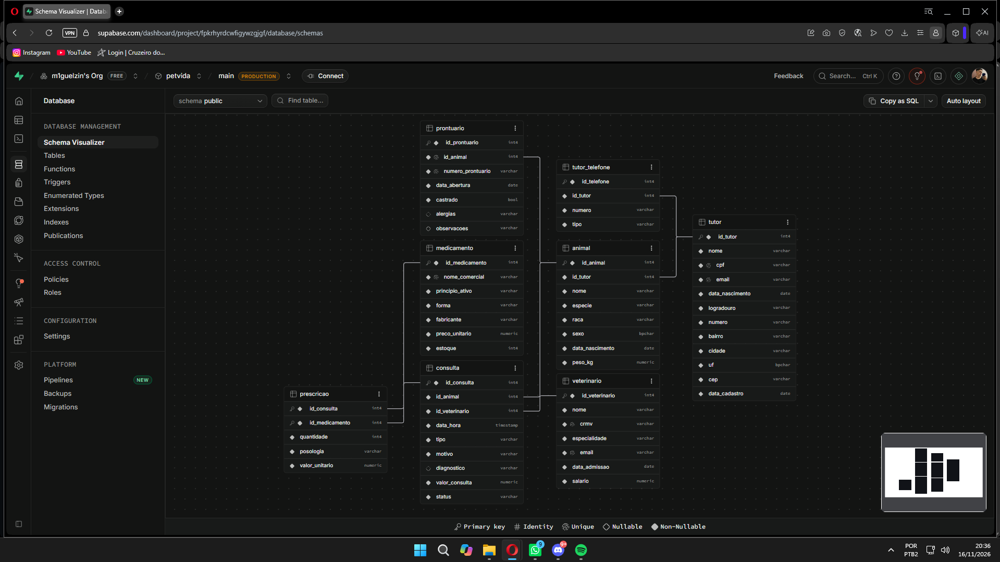

## 5. Dados

Cada tabela foi populada com `INSERT ... SELECT` e `generate_series`, escolhendo valores de listas (`ARRAY`) com o resto da divisão (`%`).

| Tabela | Registros |
|---|---:|
| tutor | 500 |
| tutor_telefone | 750 |
| animal | 650 |
| prontuario | 650 |
| veterinario | 500 |
| medicamento | 500 |
| consulta | 1.500 |
| prescricao | 1.909 |

Os dados seguem as regras de negócio:
- todo tutor tem um celular, e metade também tem telefone residencial;
- 150 tutores têm dois animais;
- raça e peso combinam com a espécie, e o DDD e o CEP combinam com a cidade;
- cada animal tem um prontuário;
- consultas futuras ficam *Agendada*;
- só consultas realizadas têm diagnóstico e medicamentos.

## 6. CRUD

Script: [`06_crud.sql`](scripts_sql/06_crud.sql). Um cliente novo é cadastrado, consultado, alterado e excluído.

**INSERT**: cadastro de tutor, telefone, animal, prontuário e consulta
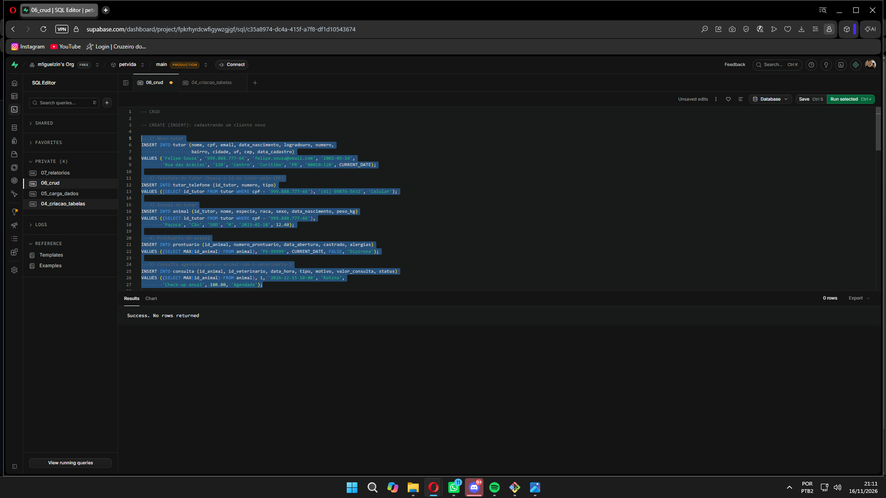

**SELECT**: dados do cliente novo, juntando as tabelas com JOIN
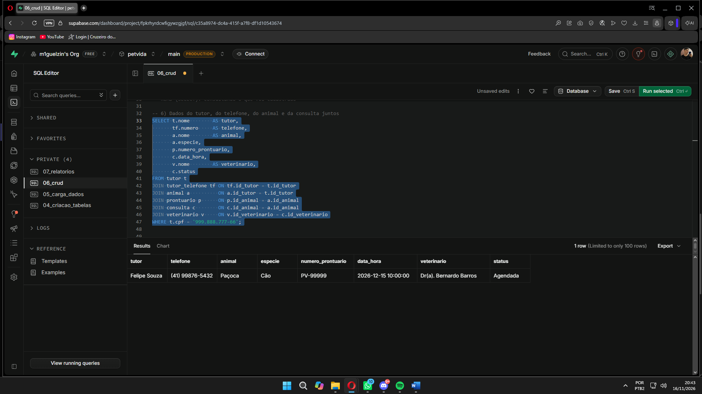

**UPDATE**: mudança de endereço e consulta marcada como realizada
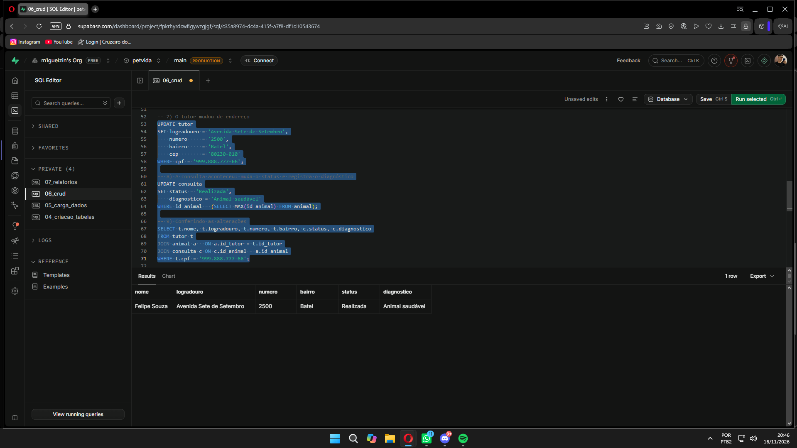

**DELETE**: o banco impede apagar um tutor que ainda tem registros ligados a ele (integridade referencial)
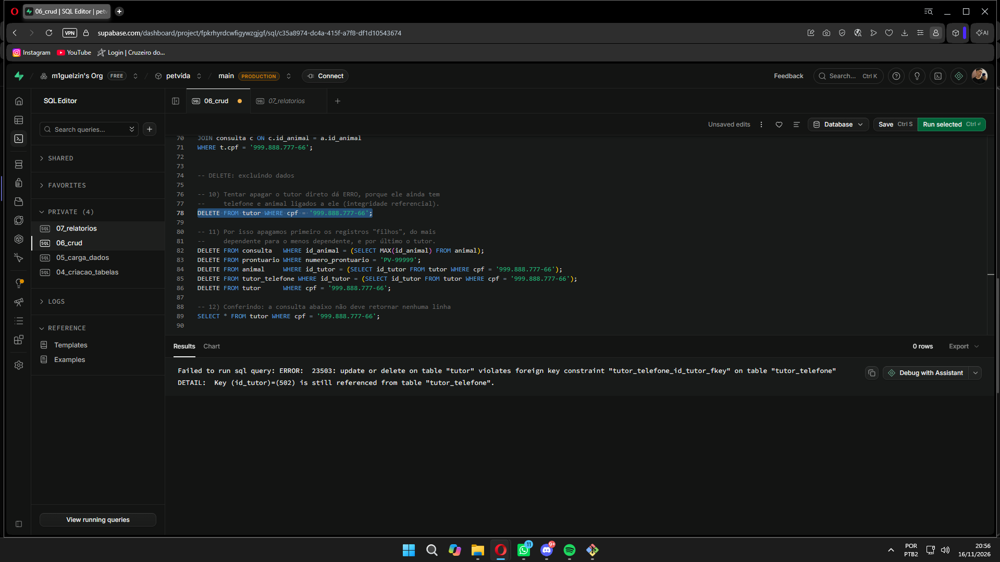

Por isso a exclusão é feita dos registros "filhos" para o "pai": consulta → prontuário → animal → telefone → tutor.
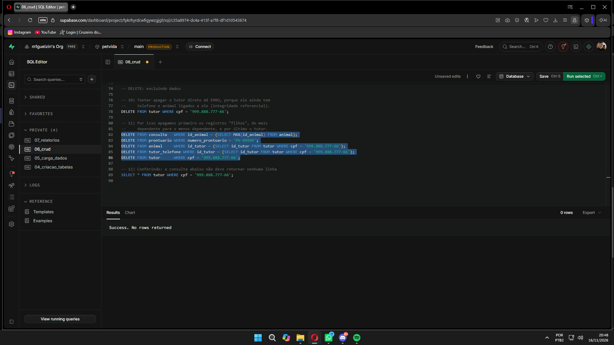

Conferência: o tutor não existe mais.
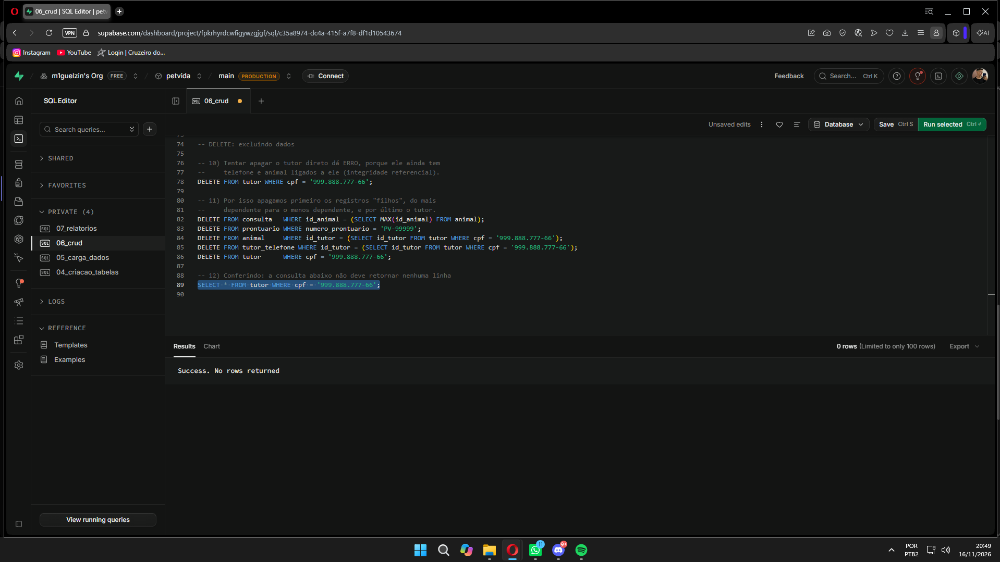

## 7. Relatórios

Script: [`07_relatorios.sql`](scripts_sql/07_relatorios.sql). Todas as consultas usam `SELECT`, `JOIN`, `WHERE` e `ORDER BY`.

<details>
<summary><b>R1. Quais consultas estão agendadas? (agenda da clínica)</b></summary>

```sql
SELECT c.data_hora,
       a.nome  AS animal,
       t.nome  AS tutor,
       v.nome  AS veterinario,
       c.motivo
FROM consulta c
JOIN animal a      ON a.id_animal = c.id_animal
JOIN tutor t       ON t.id_tutor = a.id_tutor
JOIN veterinario v ON v.id_veterinario = c.id_veterinario
WHERE c.status = 'Agendada'
ORDER BY c.data_hora;
```
</details>

<details>
<summary><b>R2. Histórico de consultas do animal com prontuário PV-00010</b></summary>

```sql
SELECT p.numero_prontuario,
       a.nome AS animal,
       c.data_hora,
       c.tipo,
       c.diagnostico,
       v.nome AS veterinario
FROM prontuario p
JOIN animal a      ON a.id_animal = p.id_animal
JOIN consulta c    ON c.id_animal = a.id_animal
JOIN veterinario v ON v.id_veterinario = c.id_veterinario
WHERE p.numero_prontuario = 'PV-00010'
ORDER BY c.data_hora;
```
</details>

<details>
<summary><b>R3. Alerta: animais que receberam um medicamento ao qual são alérgicos</b></summary>

```sql
SELECT a.nome           AS animal,
       p.alergias,
       m.nome_comercial AS medicamento_prescrito,
       c.data_hora
FROM prontuario p
JOIN animal a      ON a.id_animal = p.id_animal
JOIN consulta c    ON c.id_animal = a.id_animal
JOIN prescricao pr ON pr.id_consulta = c.id_consulta
JOIN medicamento m ON m.id_medicamento = pr.id_medicamento
WHERE m.principio_ativo = p.alergias
ORDER BY c.data_hora;
```
</details>

<details>
<summary><b>R4. Tutores de Curitiba e seus animais</b></summary>

```sql
SELECT t.nome AS tutor,
       t.bairro,
       a.nome AS animal,
       a.especie,
       a.raca
FROM tutor t
JOIN animal a ON a.id_tutor = t.id_tutor
WHERE t.cidade = 'Curitiba'
ORDER BY t.nome, a.nome;
```
</details>

<details>
<summary><b>R5. Telefones dos tutores de gatos (para campanha de vacinação felina)</b></summary>

```sql
SELECT t.nome  AS tutor,
       tf.numero,
       tf.tipo,
       a.nome  AS gato
FROM tutor t
JOIN tutor_telefone tf ON tf.id_tutor = t.id_tutor
JOIN animal a          ON a.id_tutor = t.id_tutor
WHERE a.especie = 'Gato'
ORDER BY t.nome;
```
</details>

<details>
<summary><b>R6. Cirurgias realizadas com valor acima de R$ 1.500,00</b></summary>

```sql
SELECT c.data_hora,
       a.nome AS animal,
       c.motivo,
       v.nome AS cirurgiao,
       c.valor_consulta
FROM consulta c
JOIN animal a      ON a.id_animal = c.id_animal
JOIN veterinario v ON v.id_veterinario = c.id_veterinario
WHERE c.tipo = 'Cirurgia'
  AND c.status = 'Realizada'
  AND c.valor_consulta > 1500
ORDER BY c.valor_consulta DESC;
```
</details>

<details>
<summary><b>R7. Quantas consultas realizadas cada veterinário fez (os 10 que mais atenderam)</b></summary>

```sql
SELECT v.nome,
       v.especialidade,
       COUNT(c.id_consulta) AS total_consultas
FROM veterinario v
JOIN consulta c ON c.id_veterinario = v.id_veterinario
WHERE c.status = 'Realizada'
GROUP BY v.id_veterinario, v.nome, v.especialidade
ORDER BY total_consultas DESC
LIMIT 10;
```
</details>

<details>
<summary><b>R8. Os 10 medicamentos mais prescritos</b></summary>

```sql
SELECT m.nome_comercial,
       m.fabricante,
       SUM(pr.quantidade) AS unidades_prescritas
FROM prescricao pr
JOIN medicamento m ON m.id_medicamento = pr.id_medicamento
JOIN consulta c    ON c.id_consulta = pr.id_consulta
WHERE c.status = 'Realizada'
GROUP BY m.nome_comercial, m.fabricante
ORDER BY unidades_prescritas DESC
LIMIT 10;
```
</details>

<details>
<summary><b>R9. Faturamento por cidade (valor total das consultas realizadas, usando a view do atributo derivado valor_total)</b></summary>

```sql
SELECT t.cidade,
       COUNT(c.id_consulta) AS consultas,
       SUM(vt.valor_total)  AS faturamento
FROM consulta c
JOIN vw_consulta_valor_total vt ON vt.id_consulta = c.id_consulta
JOIN animal a                   ON a.id_animal = c.id_animal
JOIN tutor t                    ON t.id_tutor = a.id_tutor
WHERE c.status = 'Realizada'
GROUP BY t.cidade
ORDER BY faturamento DESC;
```
</details>

<details>
<summary><b>R10. Animais com 12 anos ou mais (usando a view do atributo derivado idade)</b></summary>

```sql
SELECT vi.nome AS animal,
       a.especie,
       vi.idade,
       t.nome  AS tutor
FROM vw_animal_idade vi
JOIN animal a ON a.id_animal = vi.id_animal
JOIN tutor t  ON t.id_tutor = a.id_tutor
WHERE vi.idade >= 12
ORDER BY vi.idade DESC, vi.nome;
```
</details>
