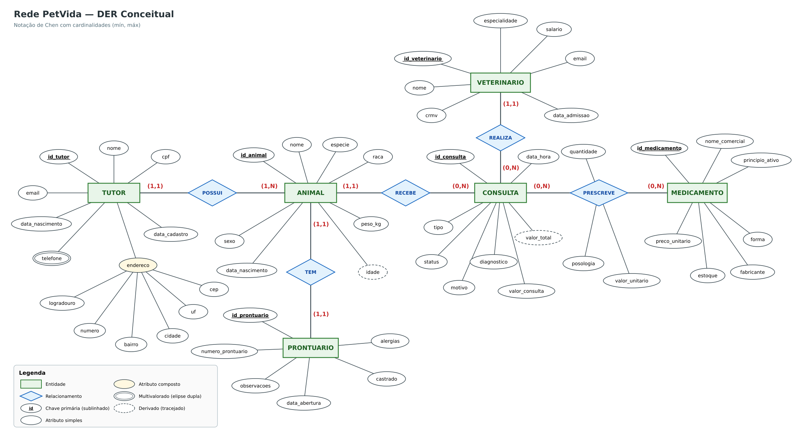
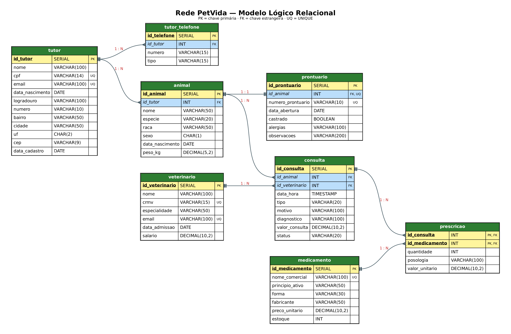

# 🐾 Rede PetVida — Modelagem de Banco de Dados

Trabalho Final do 2º Bimestre: Modelagem de Banco de Dados.  
Projeto de banco de dados para uma rede de clínicas veterinárias, implementado em **PostgreSQL no Supabase**.

---

## 1. Cenário

### A empresa

A **Rede PetVida** é uma rede de clínicas veterinárias com unidades em 8 capitais brasileiras (São Paulo, Rio de Janeiro, Belo Horizonte, Curitiba, Porto Alegre, Salvador, Recife e Goiânia). A rede atende cães, gatos, aves e coelhos, conta com cerca de 500 veterinários de diferentes especialidades e tem uma farmácia própria que vende medicamentos veterinários.

### O problema

Hoje cada unidade controla os atendimentos em planilhas e fichas de papel. Por isso:

- o histórico do animal fica preso na unidade onde ele foi atendido, e outra clínica da rede não sabe quais doenças ele teve nem se tem **alergia** a algum medicamento;
- não há uma **agenda** única das consultas;
- não se sabe quais **medicamentos** saem mais;
- a gerência não consegue ver o **faturamento** por cidade ou por veterinário.

### A solução

Um banco de dados único que guarda os **tutores**, seus **animais**, o **prontuário** de cada animal, os **veterinários**, as **consultas** e os **medicamentos prescritos** em cada consulta.

### Regras de negócio

1. Um tutor é maior de idade, tem CPF e e-mail únicos, um endereço e pode ter **vários telefones**.
2. Um tutor pode ter **um ou mais animais**, e cada animal pertence a **um único tutor**.
3. Cada animal tem **exatamente um prontuário**, e cada prontuário é de um único animal.
4. A **idade** do animal não é digitada: é calculada pela data de nascimento.
5. Uma consulta é de **um animal** com **um veterinário**. Um animal pode ter várias consultas, e um veterinário faz várias consultas.
6. A consulta pode estar *Agendada*, *Realizada* ou *Cancelada*. Só consulta realizada tem diagnóstico e medicamentos prescritos.
7. Em uma consulta podem ser prescritos **vários medicamentos**, e um medicamento pode ser prescrito em **várias consultas**. Cada prescrição guarda a quantidade, a posologia e o preço cobrado.
8. O **valor total** da consulta é calculado: valor da consulta + (quantidade × preço) dos medicamentos.

### Entidades e atributos

| Entidade | Atributos |
|---|---|
| **TUTOR** | <u>id_tutor</u>, nome, cpf, email, data_nascimento, data_cadastro, **endereco** (logradouro, numero, bairro, cidade, uf, cep), **{telefone}** |
| **ANIMAL** | <u>id_animal</u>, nome, especie, raca, sexo, data_nascimento, peso_kg, *idade* |
| **PRONTUARIO** | <u>id_prontuario</u>, numero_prontuario, data_abertura, castrado, alergias, observacoes |
| **VETERINARIO** | <u>id_veterinario</u>, nome, crmv, especialidade, email, data_admissao, salario |
| **CONSULTA** | <u>id_consulta</u>, data_hora, tipo, motivo, diagnostico, valor_consulta, status, *valor_total* |
| **MEDICAMENTO** | <u>id_medicamento</u>, nome_comercial, principio_ativo, forma, fabricante, preco_unitario, estoque |

### Tipos de atributos

| Tipo | Exemplo no projeto | Como foi implementado |
|---|---|---|
| **Simples** | `nome`, `cpf`, `especie`, `crmv` | uma coluna |
| **Composto** | `endereco` do tutor (logradouro, número, bairro, cidade, UF, CEP) | dividido em 6 colunas na tabela `tutor` |
| **Multivalorado** | `telefone` do tutor (pode ter vários) | tabela separada `tutor_telefone` |
| **Derivado** | `idade` do animal e `valor_total` da consulta | não são guardados: são calculados nas views `vw_animal_idade` e `vw_consulta_valor_total` |
| **Chave primária** | `id_tutor`, `id_animal`, `id_consulta`… | `PRIMARY KEY` (em `prescricao` a chave é composta) |

### Relacionamentos

| Relacionamento | Entidades | Tipo |
|---|---|---|
| **TEM** | ANIMAL — PRONTUARIO | **1:1** |
| **POSSUI** | TUTOR — ANIMAL | **1:N** |
| **RECEBE** | ANIMAL — CONSULTA | **1:N** |
| **REALIZA** | VETERINARIO — CONSULTA | **1:N** |
| **PRESCREVE** | CONSULTA — MEDICAMENTO | **N:N** (com os atributos quantidade, posologia e valor_unitario) |

---

## 2. Modelagem Conceitual



**Cardinalidades (mínimo, máximo)**

- **TUTOR (1,1) — POSSUI — (1,N) ANIMAL**: todo animal tem 1 tutor; um tutor tem 1 ou mais animais.
- **ANIMAL (1,1) — TEM — (1,1) PRONTUARIO**: um para um dos dois lados.
- **ANIMAL (1,1) — RECEBE — (0,N) CONSULTA**: toda consulta é de 1 animal; um animal recém-cadastrado pode ainda não ter consulta.
- **VETERINARIO (1,1) — REALIZA — (0,N) CONSULTA**: toda consulta tem 1 veterinário.
- **CONSULTA (0,N) — PRESCREVE — (0,N) MEDICAMENTO**: uma consulta pode não ter remédio (ex.: vacinação) ou ter vários; um medicamento pode estar em várias consultas.

Legenda: retângulo = entidade · losango = relacionamento · elipse = atributo · sublinhado = chave primária · elipse dupla = multivalorado · elipse tracejada = derivado · elipse amarela com ramificações = composto.

---

## 3. Modelagem Lógica



### Esquema relacional

<u>Sublinhado</u> = chave primária (PK) · *itálico* = chave estrangeira (FK)

- **tutor** (<u>id_tutor</u> SERIAL, nome VARCHAR(100), cpf VARCHAR(14), email VARCHAR(100), data_nascimento DATE, logradouro VARCHAR(100), numero VARCHAR(10), bairro VARCHAR(50), cidade VARCHAR(50), uf CHAR(2), cep VARCHAR(9), data_cadastro DATE)
- **tutor_telefone** (<u>id_telefone</u> SERIAL, *id_tutor* INT, numero VARCHAR(15), tipo VARCHAR(15))
- **animal** (<u>id_animal</u> SERIAL, *id_tutor* INT, nome VARCHAR(50), especie VARCHAR(20), raca VARCHAR(50), sexo CHAR(1), data_nascimento DATE, peso_kg DECIMAL(5,2))
- **prontuario** (<u>id_prontuario</u> SERIAL, *id_animal* INT UNIQUE, numero_prontuario VARCHAR(10), data_abertura DATE, castrado BOOLEAN, alergias VARCHAR(100), observacoes VARCHAR(200))
- **veterinario** (<u>id_veterinario</u> SERIAL, nome VARCHAR(100), crmv VARCHAR(15), especialidade VARCHAR(50), email VARCHAR(100), data_admissao DATE, salario DECIMAL(10,2))
- **consulta** (<u>id_consulta</u> SERIAL, *id_animal* INT, *id_veterinario* INT, data_hora TIMESTAMP, tipo VARCHAR(20), motivo VARCHAR(100), diagnostico VARCHAR(100), valor_consulta DECIMAL(10,2), status VARCHAR(20))
- **medicamento** (<u>id_medicamento</u> SERIAL, nome_comercial VARCHAR(100), principio_ativo VARCHAR(50), forma VARCHAR(30), fabricante VARCHAR(50), preco_unitario DECIMAL(10,2), estoque INT)
- **prescricao** (<u>*id_consulta*</u> INT, <u>*id_medicamento*</u> INT, quantidade INT, posologia VARCHAR(100), valor_unitario DECIMAL(10,2))

### Como o DER virou tabelas

| No DER | No modelo lógico |
|---|---|
| Cada entidade | uma tabela, com o identificador como chave primária |
| Atributo composto `endereco` | 6 colunas na tabela `tutor` |
| Atributo multivalorado `telefone` | tabela `tutor_telefone` com FK para `tutor` |
| Atributos derivados `idade` e `valor_total` | não viram coluna; são calculados em views |
| Relacionamento 1:1 (animal–prontuário) | FK `id_animal` em `prontuario` com `UNIQUE` |
| Relacionamentos 1:N | FK do lado N (`animal.id_tutor`, `consulta.id_animal`, `consulta.id_veterinario`) |
| Relacionamento N:N (consulta–medicamento) | tabela `prescricao`, com chave primária composta pelas duas FKs |

**Tipos de dados escolhidos:** `SERIAL` para os ids (número automático), `VARCHAR` para textos, `CHAR` para textos de tamanho fixo (UF e sexo), `DATE` para datas, `TIMESTAMP` para data e hora da consulta, `DECIMAL` para valores em dinheiro e peso, `INT` para quantidades e `BOOLEAN` para sim/não.

---

## 4. Modelagem Física

O banco foi criado no **Supabase** (PostgreSQL) com o script [`sql/01_criacao_tabelas.sql`](sql/01_criacao_tabelas.sql).

### Ordem de execução no SQL Editor do Supabase

1. `01_criacao_tabelas.sql`: cria as tabelas e as views.
2. `06_seguranca_supabase.sql`: ativa o RLS (explicado abaixo).
3. `02_carga_dados.sql`: insere os dados.
4. `05_verificacao.sql`: confere a quantidade de registros.
5. `03_crud.sql` e `04_relatorios.sql`.

### Restrições usadas

| Restrição | Para que serve | Exemplos |
|---|---|---|
| `PRIMARY KEY` | identifica cada linha | `id_tutor`, `id_animal`; em `prescricao` é (`id_consulta`, `id_medicamento`) |
| `REFERENCES` (chave estrangeira) | garante a **integridade referencial**: não deixa cadastrar um animal de um tutor que não existe, nem apagar um tutor que ainda tem animais | `animal.id_tutor`, `consulta.id_animal` |
| `NOT NULL` | campo obrigatório | `nome`, `cpf`, `data_hora` |
| `UNIQUE` | não deixa repetir | `cpf`, `email`, `crmv`, `prontuario.id_animal` (garante o 1:1) |
| `CHECK` | só aceita valores válidos | `sexo IN ('M','F')`, `status IN ('Agendada','Realizada','Cancelada')`, `peso_kg > 0` |

**Segurança no Supabase:** o Supabase cria uma API pública para as tabelas. O script `06_seguranca_supabase.sql` ativa o *Row Level Security* (RLS). Sem nenhuma regra criada, ninguém consegue acessar os dados por essa API, e o painel do Supabase continua funcionando normalmente.

### Prints do Supabase

**Script de criação executado no SQL Editor**


**Tabelas criadas (Table Editor)**


**Diagrama das tabelas (Database → Schema Visualizer)**


---

## 5. Dados

Os dados foram inseridos com o script [`sql/02_carga_dados.sql`](sql/02_carga_dados.sql). Em vez de escrever milhares de `INSERT` à mão, cada tabela usa `INSERT ... SELECT` com `generate_series(1, N)`, que gera os números de 1 até N. Para variar os dados, o script escolhe nomes, cidades, raças etc. de listas (`ARRAY`) usando o resto da divisão (`%`).

| Tabela | Registros |
|---|---:|
| tutor | 500 |
| tutor_telefone | 750 |
| animal | 650 |
| prontuario | 650 |
| veterinario | 500 |
| medicamento | 500 |
| consulta | 1.500 |
| prescricao | 1.889 |
| **Total** | **6.939** |

**Coerência com as regras de negócio**

- todos os tutores são maiores de idade; o DDD do telefone e o CEP são da cidade do tutor;
- todo tutor tem um celular, e metade deles também tem um telefone residencial;
- todo tutor tem pelo menos um animal, e 150 tutores têm dois;
- a raça e o peso combinam com a espécie (um labrador pesa cerca de 30 kg, uma calopsita menos de 0,5 kg);
- cada animal tem exatamente um prontuário;
- as consultas acontecem depois do nascimento do animal e da contratação do veterinário;
- consultas com data futura ficam *Agendada*; as passadas ficam *Realizada* ou *Cancelada*;
- só consultas realizadas (e que não são vacinação) têm diagnóstico e medicamentos prescritos, com o preço do medicamento.

**Contagem dos registros (`05_verificacao.sql`)**


---

## 6. CRUD

Script: [`sql/03_crud.sql`](sql/03_crud.sql). O exemplo cadastra um cliente novo, consulta, altera e depois apaga os dados dele.

### Create (INSERT)

Cadastro de um tutor, do telefone, do animal, do prontuário e de uma consulta agendada.

```sql
INSERT INTO tutor (nome, cpf, email, data_nascimento, logradouro, numero,
                   bairro, cidade, uf, cep, data_cadastro)
VALUES ('Felipe Souza', '999.888.777-66', 'felipe.souza@email.com', '2002-05-14',
        'Rua das Acácias', '120', 'Centro', 'Curitiba', 'PR', '80010-120', CURRENT_DATE);
```


### Read (SELECT)

Busca os dados do tutor, do telefone, do animal, do prontuário e da consulta juntos, usando `JOIN`.


### Update (UPDATE)

O tutor mudou de endereço, e a consulta passou de *Agendada* para *Realizada*, com diagnóstico.

```sql
UPDATE tutor
SET logradouro = 'Avenida Sete de Setembro',
    numero     = '2500',
    bairro     = 'Batel',
    cep        = '80230-010'
WHERE cpf = '999.888.777-66';
```


### Delete (DELETE)

Primeiro tentamos apagar o tutor direto, e o banco **não deixa**, porque ele ainda tem telefone e animal ligados a ele. Isso mostra a integridade referencial funcionando:


Depois apagamos na ordem certa, dos registros "filhos" para o "pai": consulta → prontuário → animal → telefone → tutor.


---

## 7. Relatórios

Script: [`sql/04_relatorios.sql`](sql/04_relatorios.sql). Todos usam `SELECT`, `JOIN`, `WHERE` e `ORDER BY`.

| # | Pergunta |
|---|---|
| R1 | Quais consultas estão agendadas? |
| R2 | Qual o histórico de consultas do animal com prontuário PV-00010? |
| R3 | Algum animal recebeu um medicamento ao qual é alérgico? |
| R4 | Quais tutores moram em Curitiba e quais são seus animais? |
| R5 | Quais os telefones dos tutores de gatos? |
| R6 | Quais cirurgias realizadas custaram mais de R$ 1.500,00? |
| R7 | Quais os 10 veterinários que mais fizeram consultas? |
| R8 | Quais os 10 medicamentos mais prescritos? |
| R9 | Qual o faturamento de cada cidade? |
| R10 | Quais animais têm 12 anos ou mais? |

### R1. Quais consultas estão agendadas? (agenda da clínica)

```sql
SELECT c.data_hora,
       a.nome  AS animal,
       t.nome  AS tutor,
       v.nome  AS veterinario,
       c.motivo
FROM consulta c
JOIN animal a      ON a.id_animal = c.id_animal
JOIN tutor t       ON t.id_tutor = a.id_tutor
JOIN veterinario v ON v.id_veterinario = c.id_veterinario
WHERE c.status = 'Agendada'
ORDER BY c.data_hora;
```

### R2. Histórico de consultas do animal com prontuário PV-00010

```sql
SELECT p.numero_prontuario,
       a.nome AS animal,
       c.data_hora,
       c.tipo,
       c.diagnostico,
       v.nome AS veterinario
FROM prontuario p
JOIN animal a      ON a.id_animal = p.id_animal
JOIN consulta c    ON c.id_animal = a.id_animal
JOIN veterinario v ON v.id_veterinario = c.id_veterinario
WHERE p.numero_prontuario = 'PV-00010'
ORDER BY c.data_hora;
```

### R3. Alerta: animais que receberam um medicamento ao qual são alérgicos

```sql
SELECT a.nome           AS animal,
       p.alergias,
       m.nome_comercial AS medicamento_prescrito,
       c.data_hora
FROM prontuario p
JOIN animal a      ON a.id_animal = p.id_animal
JOIN consulta c    ON c.id_animal = a.id_animal
JOIN prescricao pr ON pr.id_consulta = c.id_consulta
JOIN medicamento m ON m.id_medicamento = pr.id_medicamento
WHERE m.principio_ativo = p.alergias
ORDER BY c.data_hora;
```

### R4. Tutores de Curitiba e seus animais

```sql
SELECT t.nome AS tutor,
       t.bairro,
       a.nome AS animal,
       a.especie,
       a.raca
FROM tutor t
JOIN animal a ON a.id_tutor = t.id_tutor
WHERE t.cidade = 'Curitiba'
ORDER BY t.nome, a.nome;
```

### R5. Telefones dos tutores de gatos (para campanha de vacinação felina)

```sql
SELECT t.nome  AS tutor,
       tf.numero,
       tf.tipo,
       a.nome  AS gato
FROM tutor t
JOIN tutor_telefone tf ON tf.id_tutor = t.id_tutor
JOIN animal a          ON a.id_tutor = t.id_tutor
WHERE a.especie = 'Gato'
ORDER BY t.nome;
```

### R6. Cirurgias realizadas com valor acima de R$ 1.500,00

```sql
SELECT c.data_hora,
       a.nome AS animal,
       c.motivo,
       v.nome AS cirurgiao,
       c.valor_consulta
FROM consulta c
JOIN animal a      ON a.id_animal = c.id_animal
JOIN veterinario v ON v.id_veterinario = c.id_veterinario
WHERE c.tipo = 'Cirurgia'
  AND c.status = 'Realizada'
  AND c.valor_consulta > 1500
ORDER BY c.valor_consulta DESC;
```

### R7. Quantas consultas realizadas cada veterinário fez (os 10 que mais atenderam)

```sql
SELECT v.nome,
       v.especialidade,
       COUNT(c.id_consulta) AS total_consultas
FROM veterinario v
JOIN consulta c ON c.id_veterinario = v.id_veterinario
WHERE c.status = 'Realizada'
GROUP BY v.id_veterinario, v.nome, v.especialidade
ORDER BY total_consultas DESC
LIMIT 10;
```

### R8. Os 10 medicamentos mais prescritos

```sql
SELECT m.nome_comercial,
       m.fabricante,
       SUM(pr.quantidade) AS unidades_prescritas
FROM prescricao pr
JOIN medicamento m ON m.id_medicamento = pr.id_medicamento
JOIN consulta c    ON c.id_consulta = pr.id_consulta
WHERE c.status = 'Realizada'
GROUP BY m.nome_comercial, m.fabricante
ORDER BY unidades_prescritas DESC
LIMIT 10;
```

### R9. Faturamento por cidade (valor total das consultas realizadas, usando a view do atributo derivado valor_total)

```sql
SELECT t.cidade,
       COUNT(c.id_consulta) AS consultas,
       SUM(vt.valor_total)  AS faturamento
FROM consulta c
JOIN vw_consulta_valor_total vt ON vt.id_consulta = c.id_consulta
JOIN animal a                   ON a.id_animal = c.id_animal
JOIN tutor t                    ON t.id_tutor = a.id_tutor
WHERE c.status = 'Realizada'
GROUP BY t.cidade
ORDER BY faturamento DESC;
```

### R10. Animais com 12 anos ou mais (usando a view do atributo derivado idade)

```sql
SELECT vi.nome AS animal,
       a.especie,
       vi.idade,
       t.nome  AS tutor
FROM vw_animal_idade vi
JOIN animal a ON a.id_animal = vi.id_animal
JOIN tutor t  ON t.id_tutor = a.id_tutor
WHERE vi.idade >= 12
ORDER BY vi.idade DESC, vi.nome;
```
